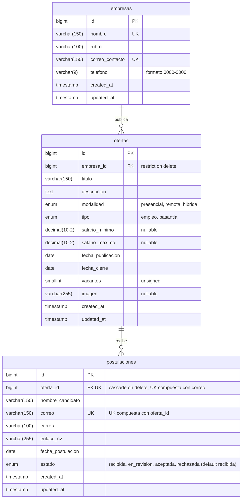

# Bolsa de Empleo y Pasantías

**Caso 7** · Asignatura: **Desarrollo Web con Software Libre**
Universidad Católica de El Salvador (UNICAES)

## Integrantes

| Integrante | Usuario de GitHub |
|------------|-------------------|
| Gustavo    | [@Gu2tavo12](https://github.com/Gu2tavo12) |
| Jimmy      | [@Jimmy-ERC](https://github.com/Jimmy-ERC) |
| Josué / Andrés Galán | [@andrees205](https://github.com/andrees205) |
| Bryan      | [@Bryan-Escobar](https://github.com/Bryan-Escobar) |
| Kevin      | [@kevRodrguez](https://github.com/kevRodrguez) |

---

## Descripción

Sistema web para que las empresas publiquen **ofertas de empleo y pasantías** y para gestionar las
**postulaciones de estudiantes** a esas ofertas.

### Fase 1 (30 %)

- Base de datos completa creada con migraciones.
- Modelos Eloquent con sus relaciones.
- Datos de prueba (factories y seeders).
- Listado paginado de ofertas.
- Ficha (detalle) de cada oferta.

### Fase 2 · Cambios respecto a la Fase 1

- El listado de ofertas incorpora búsqueda y filtros por modalidad y tipo, con paginación. La ficha enlaza la empresa y las postulaciones.
- Ofertas, empresas y postulaciones se pueden registrar, consultar, editar y eliminar con confirmación. Las postulaciones también se pueden filtrar y cambiar de estado.
- Los formularios validan en el servidor, conservan la entrada anterior y muestran los errores por campo.
- Las ofertas admiten una imagen opcional con vista previa, reemplazo, limpieza al eliminar e imagen predeterminada.
- El panel incorpora accesos a los cuatro módulos y el reporte reúne los tres indicadores del Caso 7.

---

## Tecnologías y requisitos

| Componente | Versión / detalle |
|------------|-------------------|
| PHP        | 8.4 o superior compatible con el lock. Las dependencias Symfony bloqueadas requieren PHP 8.4. |
| Composer   | 2.2 o posterior dentro de Composer 2 |
| Framework  | Laravel 13.40.0 en `composer.lock` |
| Base de datos | MySQL. También se puede usar MariaDB de XAMPP mediante la conexión `mysql`. |
| Extensiones PHP | Para la aplicación y las dependencias, habilitar `pdo_mysql`, `fileinfo`, `mbstring`, `ctype`, `dom`, `filter`, `hash`, `iconv`, `json`, `libxml`, `openssl`, `pcre`, `phar`, `session`, `tokenizer`, `xml` y `xmlwriter`. Para la suite de pruebas, habilitar además `pdo_sqlite` y `gd` con soporte de JPEG, PNG y WebP. |
| Interfaz   | Blade + Bootstrap 5.3 por CDN + CSS propio (`public/css/estilos.css`), **sin Vite ni npm** |
| Acceso a datos | Eloquent ORM |

---

## Instalación

1. Clonar el repositorio:

   ```bash
   git clone https://github.com/Gu2tavo12/proyecto-final-laravel-equipo2.git
   ```

   ```bash
   cd proyecto-final-laravel-equipo2
   ```

2. Instalar las dependencias de PHP:

   ```bash
   composer install
   composer check-platform-reqs --lock
   ```

3. Crear el archivo `.env` a partir del ejemplo.

   Windows:

   ```bash
   copy .env.example .env
   ```

   Linux / Mac:

   ```bash
   cp .env.example .env
   ```

4. Generar la clave de la aplicación:

   ```bash
   php artisan key:generate
   ```

5. Crear la base de datos vacía `bolsa_empleo` en MySQL (por ejemplo desde phpMyAdmin) con
   cotejamiento `utf8mb4_unicode_ci`:

   ```sql
   CREATE DATABASE bolsa_empleo CHARACTER SET utf8mb4 COLLATE utf8mb4_unicode_ci;
   ```

   Revisar en `.env` que los datos de conexión coincidan con tu MySQL:

   ```env
   DB_CONNECTION=mysql
   DB_HOST=127.0.0.1
   DB_PORT=3306
   DB_DATABASE=bolsa_empleo
   DB_USERNAME=root
   DB_PASSWORD=
   ```

6. Crear las tablas y cargar los datos de prueba:

   ```bash
   php artisan migrate --seed
   ```

7. Crear el enlace simbólico para los archivos públicos:

   ```bash
   php artisan storage:link
   ```

8. Levantar el servidor de desarrollo:

   ```bash
   php artisan serve
   ```

   Abrir <http://localhost:8000> en el navegador.

### Ensayo para la defensa

Crea una segunda base de datos vacía en el servidor local y apunta `DB_DATABASE` en `.env` a esa base desechable.

```sql
CREATE DATABASE bolsa_empleo_demo CHARACTER SET utf8mb4 COLLATE utf8mb4_unicode_ci;
```

```bash
php artisan config:clear
php artisan migrate:fresh --seed
php artisan route:list --except-vendor
php artisan test
```

`migrate:fresh --seed` elimina todas las tablas de la conexión configurada y vuelve a cargar los datos ficticios. Verifica `DB_DATABASE=bolsa_empleo_demo` antes de ejecutarlo y reserva ese comando para la base desechable. El seeder carga 6 empresas, 20 ofertas y 40 postulaciones. Incluye una oferta que cierra hoy, ofertas cerradas y una pasantía sin postulaciones. Para demostrar la validación de duplicados, usa `ana.demo@example.com` en «Desarrollador Laravel Senior». La suite automatizada usa SQLite en memoria.

---

## Modelo de datos



| Tabla | Descripción | Relación | Al eliminar | Justificación |
|-------|-------------|----------|-------------|---------------|
| `empresas` | Catálogo de empresas que publican ofertas (nombre y correo únicos). | 1:N con `ofertas` | — | Tabla padre; no depende de otra tabla. |
| `ofertas` | Entidad principal: ofertas de empleo o pasantía de una empresa. | N:1 con `empresas` (`empresa_id`) · 1:N con `postulaciones` | **restrict** | No se puede borrar una empresa que todavía tiene ofertas, para no dejar ofertas sin empresa ni perder información por accidente. |
| `postulaciones` | Entidad relacionada: candidatos que se postulan a una oferta. Un mismo correo solo puede postularse una vez por oferta (`unique(oferta_id, correo)`). | N:1 con `ofertas` (`oferta_id`) | **cascade** | Una postulación no tiene sentido sin su oferta: si se elimina la oferta, se eliminan sus postulaciones. |

---

## Reglas de negocio (Fase 2)

| Regla | Archivo y método |
|-------|------------------|
| Ambos salarios son obligatorios en empleos y opcionales en pasantías. Si se informan ambos, el mínimo debe ser menor o igual al máximo. El cierre debe ser posterior a la publicación y se requieren entre 1 y 65 535 vacantes. | [`StoreOfertaRequest::rules()`](app/Http/Requests/StoreOfertaRequest.php), heredado por [`UpdateOfertaRequest`](app/Http/Requests/UpdateOfertaRequest.php). |
| La imagen es opcional. Se admiten JPG, PNG y WebP de hasta 2 MB y se verifica el tipo por contenido. La imagen se guarda en el disco público. | [`StoreOfertaRequest::rules()`](app/Http/Requests/StoreOfertaRequest.php) y [`OfertaController::guardarImagen()`, `update()` y `destroy()`](app/Http/Controllers/OfertaController.php). |
| El correo se normaliza y solo puede aparecer una vez por oferta. El CV debe usar una URL HTTP o HTTPS. | [`StorePostulacionRequest::prepareForValidation()` y `reglasCandidato()`](app/Http/Requests/StorePostulacionRequest.php), [`UpdatePostulacionRequest::rules()`](app/Http/Requests/UpdatePostulacionRequest.php) y [migración de postulaciones, `up()`](database/migrations/2026_11_04_193621_create_postulaciones_table.php). |
| Una oferta acepta nuevas postulaciones hasta su fecha de cierre inclusive. Las postulaciones históricas se pueden editar. | [`Oferta::scopeActivas()` y `estaActiva()`](app/Models/Oferta.php), [`StorePostulacionRequest::rules()`](app/Http/Requests/StorePostulacionRequest.php) y [`PostulacionController::store()` y `update()`](app/Http/Controllers/PostulacionController.php). |
| El nombre y el correo de contacto de la empresa son únicos. Una empresa con ofertas queda protegida contra eliminación y al eliminar una oferta se eliminan sus postulaciones. | [`StoreEmpresaRequest::rules()`](app/Http/Requests/StoreEmpresaRequest.php), [`UpdateEmpresaRequest::rules()`](app/Http/Requests/UpdateEmpresaRequest.php), [`EmpresaController::destroy()`](app/Http/Controllers/EmpresaController.php) y migraciones de [ofertas](database/migrations/2026_11_04_193606_create_ofertas_table.php) y [postulaciones](database/migrations/2026_11_04_193621_create_postulaciones_table.php), método `up()`. |

### Reporte del caso 7

El reporte está disponible en `/reporte` (`reporte.index`) y se calcula en [`ReporteController::index()`](app/Http/Controllers/ReporteController.php). Una oferta se considera activa si su
fecha de cierre es hoy o posterior.

- **Ofertas activas por modalidad.** Muestra todas las modalidades, incluidas las que tienen cero ofertas activas.
- **Postulaciones por oferta.** Cuenta las postulaciones de cada oferta activa o cerrada, incluidas las que tienen cero.
- **Ranking de empresas.** Incluye a las empresas con ofertas activas y las ordena de mayor a menor por la suma de vacantes de esas ofertas. Los empates se ordenan por nombre de empresa y luego por ID.

---

## Capturas de pantalla


---

## Aportes por integrante

| Integrante | Fase 1 | Fase 2 |
|------------|--------|--------|
| Gustavo | Proyecto, MySQL, README, panel inicial, integración y etiqueta `v1.0`. | Panel, reporte, pruebas de agregados y navegación, README y evidencia. |
| Jimmy | Migraciones, restricciones y diagrama entidad-relación. | CRUD de empresas, Form Requests y pruebas de integridad del catálogo. |
| Josué / Andrés Galán | Modelos Eloquent, relaciones, controlador y rutas de ofertas. | CRUD y filtros de ofertas, reglas de validación, Storage y pruebas de escritura. |
| Bryan | Seeders y factories de los datos de prueba. | CRUD y filtros de postulaciones, reglas de candidato, pruebas y datos de demostración. |
| Kevin | Layout Bootstrap, CSS, imagen predeterminada, listado y ficha de ofertas. | Formularios reutilizables, diseño móvil, filtros visibles, ficha con postulaciones y navegación entre módulos. |

---

## Etiquetas de conceptos en el código

| Etiqueta | Archivos donde aparece |
|----------|------------------------|
| `[MIGRACION]` | `database/migrations/*_create_empresas_table.php`, `*_create_ofertas_table.php`, `*_create_postulaciones_table.php` |
| `[RELACION]` | `app/Models/Empresa.php`, `app/Models/Oferta.php`, `app/Models/Postulacion.php`, `database/migrations/*_create_ofertas_table.php`, `*_create_postulaciones_table.php` |
| `[ENCAPSULAMIENTO]` | `app/Models/Empresa.php`, `app/Models/Oferta.php`, `app/Models/Postulacion.php` |
| `[CRUD-CREATE]`, `[CRUD-READ]`, `[CRUD-UPDATE]`, `[CRUD-DELETE]` | `app/Http/Controllers/{Oferta,Empresa,Postulacion}Controller.php` y sus vistas en `resources/views/`. También aparece `[CRUD-READ]` en `PanelController.php` y `panel/index.blade.php`. |
| `[INYECCION-DEPENDENCIAS]` | `app/Http/Controllers/{Oferta,Empresa,Postulacion}Controller.php`, junto a la inyección de Form Requests y el enlace de modelos a rutas. |
| `[SEEDER]` | `database/seeders/EmpresaSeeder.php` y `database/seeders/DemostracionSeeder.php`. |
| `[VALIDACION]`, `[REGLA-NEGOCIO]` | `app/Http/Requests/`, `app/Http/Controllers/PostulacionController.php` y los parciales `_form.blade.php` de cada módulo. |
| `[SEGURIDAD]` | `app/Http/Controllers/{Oferta,Postulacion}Controller.php`, `app/Http/Requests/StoreOfertaRequest.php`, `app/Http/Requests/StorePostulacionRequest.php`, `app/Models/Postulacion.php` y vistas de los módulos con CSRF, DELETE y enlaces de CV. |
| `[ACCESIBILIDAD]` | `resources/views/layouts/app.blade.php` y `resources/views/partials/modal-confirmar-eliminar.blade.php`. |

---

## Flujo de trabajo en Git

- **Ramas:** `main` es la rama estable. Cada tarea se desarrolla en su propia rama `feature/<descripcion>`
  (por ejemplo `feature/migraciones`, `feature/listado-ofertas`).
- **Pull requests:** los cambios llegan a `main` solo mediante pull request revisado por otro integrante.
- **Commits:** se usa [Conventional Commits](https://www.conventionalcommits.org/es/) en español y sin tildes
  (`feat:`, `fix:`, `docs:`, `chore:`, `refactor:`...). Ejemplo: `feat(ofertas): agrega listado paginado`.
- **Etiquetas de entrega.** La Fase 1 está en [`v1.0`](../../releases/tag/v1.0). La etiqueta `v2.0` corresponde al cierre de la Fase 2. Se consultan en [Tags de GitHub](../../tags) o con `git tag --list`.
