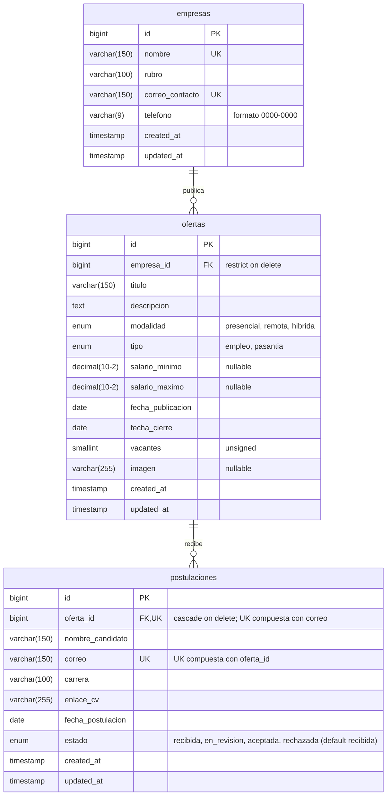

# Bolsa de Empleo y Pasantías

**Caso 7** · Asignatura: **Desarrollo Web con Software Libre**
Universidad Católica de El Salvador (UNICAES)

## Integrantes

| Integrante | Usuario de GitHub |
|------------|-------------------|
| Gustavo    | [@Gu2tavo12](https://github.com/Gu2tavo12) |
| Jimmy      | [@Jimmy-ERC](https://github.com/Jimmy-ERC) |
| Andrés     | [@andrees205](https://github.com/andrees205) |
| Bryan      | [@Bryan-Escobar](https://github.com/Bryan-Escobar) |
| Kevin      | [@kevRodrguez](https://github.com/kevRodrguez) |

---

## Descripción

Sistema web para que las empresas publiquen **ofertas de empleo y pasantías** y para gestionar las
**postulaciones de estudiantes** a esas ofertas.

### Fase 1 (30 %)

- Base de datos completa creada con migraciones.
- Modelos Eloquent con sus relaciones.
- Datos de prueba (factories y seeders).
- Listado paginado de ofertas.
- Ficha (detalle) de cada oferta.

### Fase 2

- CRUD completo de ofertas, empresas y postulaciones.
- Registro de postulaciones de estudiantes.
- Validación de formularios.
- Carga de imágenes.
- Reglas de negocio del caso (ver más abajo).
- Panel y reporte.

---

## Tecnologías y requisitos

| Componente | Versión / detalle |
|------------|-------------------|
| PHP        | 8.3 o superior |
| Composer   | 2.x |
| Framework  | Laravel 13 |
| Base de datos | MySQL (XAMPP) |
| Extensiones PHP | `pdo_mysql`, `fileinfo`, `mbstring` |
| Interfaz   | Blade + Bootstrap 5.3 por CDN + CSS propio (`public/css/estilos.css`), **sin Vite ni npm** |
| Acceso a datos | Eloquent ORM |

---

## Instalación

1. Clonar el repositorio:

   ```bash
   git clone https://github.com/Gu2tavo12/proyecto-final-laravel-equipo2.git
   ```

   ```bash
   cd proyecto-final-laravel-equipo2
   ```

2. Instalar las dependencias de PHP:

   ```bash
   composer install
   ```

3. Crear el archivo `.env` a partir del ejemplo.

   Windows:

   ```bash
   copy .env.example .env
   ```

   Linux / Mac:

   ```bash
   cp .env.example .env
   ```

4. Generar la clave de la aplicación:

   ```bash
   php artisan key:generate
   ```

5. Crear la base de datos vacía `bolsa_empleo` en MySQL (por ejemplo desde phpMyAdmin) con
   cotejamiento `utf8mb4_unicode_ci`:

   ```sql
   CREATE DATABASE bolsa_empleo CHARACTER SET utf8mb4 COLLATE utf8mb4_unicode_ci;
   ```

   Revisar en `.env` que los datos de conexión coincidan con tu MySQL:

   ```env
   DB_CONNECTION=mysql
   DB_HOST=127.0.0.1
   DB_PORT=3306
   DB_DATABASE=bolsa_empleo
   DB_USERNAME=root
   DB_PASSWORD=
   ```

6. Crear las tablas y cargar los datos de prueba:

   ```bash
   php artisan migrate:fresh --seed
   ```

7. Crear el enlace simbólico para los archivos públicos:

   ```bash
   php artisan storage:link
   ```

8. Levantar el servidor de desarrollo:

   ```bash
   php artisan serve
   ```

   Abrir <http://127.0.0.1:8000> en el navegador.

---

## Modelo de datos



| Tabla | Descripción | Relación | Al eliminar | Justificación |
|-------|-------------|----------|-------------|---------------|
| `empresas` | Catálogo de empresas que publican ofertas (nombre y correo únicos). | 1:N con `ofertas` | — | Tabla padre; no depende de otra tabla. |
| `ofertas` | Entidad principal: ofertas de empleo o pasantía de una empresa. | N:1 con `empresas` (`empresa_id`) · 1:N con `postulaciones` | **restrict** | No se puede borrar una empresa que todavía tiene ofertas, para no dejar ofertas sin empresa ni perder información por accidente. |
| `postulaciones` | Entidad relacionada: candidatos que se postulan a una oferta. Un mismo correo solo puede postularse una vez por oferta (`unique(oferta_id, correo)`). | N:1 con `ofertas` (`oferta_id`) | **cascade** | Una postulación no tiene sentido sin su oferta: si se elimina la oferta, se eliminan sus postulaciones. |

---

## Reglas de negocio (Fase 2)

- El salario mínimo debe ser menor o igual al salario máximo (ambos son opcionales en pasantías).
- La fecha de cierre debe ser posterior a la fecha de publicación.
- El número de vacantes debe ser mayor que 0.
- Un mismo correo no puede postularse dos veces a la misma oferta.
- No se aceptan postulaciones en ofertas cerradas.
- El enlace del CV debe tener formato de URL válida.

---

## Capturas de pantalla


---

## Distribución del trabajo

| Integrante | Tareas realizadas |
|------------|-------------------|
| Gustavo    | Creación del proyecto, configuración de MySQL/`.env.example`, README, `PanelController` y panel de inicio, integración de PR y etiqueta `v1.0`. |
| Jimmy      | Migraciones de `empresas`, `ofertas` y `postulaciones` con llaves foráneas y restricciones; diagrama entidad-relación. |
| Andrés     | Modelos Eloquent `Empresa`, `Oferta` y `Postulacion` (fillable, casts, relaciones, scope y accessor); `OfertaController` (index, show) y rutas resource. |
| Bryan      | `EmpresaSeeder`, `OfertaFactory`, `PostulacionFactory` y `DatabaseSeeder` (datos de prueba). |
| Kevin      | Layout Blade con Bootstrap, `estilos.css`, imagen por defecto, vistas de listado paginado y ficha de detalle. |

---

## Estado de la Fase 1

- [x] Base de datos creada con migraciones (`empresas`, `ofertas`, `postulaciones`) con llaves foráneas y restricciones.
- [x] Modelos Eloquent con relaciones, `fillable`, casts, scope `activas()` y accessors (`imagen_url`, `rango_salarial`).
- [x] Datos de prueba con seeders y factories (6 empresas, 21 ofertas, 56 postulaciones).
- [x] Listado paginado de ofertas (`/ofertas`).
- [x] Ficha de detalle de cada oferta con su empresa y postulaciones (`/ofertas/{oferta}`).
- [x] Panel de inicio con indicadores básicos (`/`).
- [x] Interfaz con layout Blade, Bootstrap 5.3 por CDN y CSS propio.
- [x] Trabajo integrado en `main` mediante pull requests y etiqueta `v1.0`.

### Etiquetas de conceptos en el código

| Etiqueta | Archivos donde aparece |
|----------|------------------------|
| `[MIGRACION]` | `database/migrations/*_create_empresas_table.php`, `*_create_ofertas_table.php`, `*_create_postulaciones_table.php` |
| `[RELACION]` | `app/Models/Empresa.php`, `app/Models/Oferta.php`, `app/Models/Postulacion.php`, `database/migrations/*_create_ofertas_table.php`, `*_create_postulaciones_table.php` |
| `[ENCAPSULAMIENTO]` | `app/Models/Empresa.php`, `app/Models/Oferta.php`, `app/Models/Postulacion.php` |
| `[CRUD-READ]` | `app/Http/Controllers/OfertaController.php`, `app/Http/Controllers/PanelController.php`, `resources/views/ofertas/index.blade.php`, `resources/views/ofertas/show.blade.php`, `resources/views/panel/index.blade.php` |
| `[INYECCION-DEPENDENCIAS]` | `app/Http/Controllers/OfertaController.php` |
| `[SEEDER]` | `database/seeders/EmpresaSeeder.php` |

---

## Flujo de trabajo en Git

- **Ramas:** `main` es la rama estable. Cada tarea se desarrolla en su propia rama `feature/<descripcion>`
  (por ejemplo `feature/migraciones`, `feature/listado-ofertas`).
- **Pull requests:** los cambios llegan a `main` solo mediante pull request revisado por otro integrante.
- **Commits:** se usa [Conventional Commits](https://www.conventionalcommits.org/es/) en español y sin tildes
  (`feat:`, `fix:`, `docs:`, `chore:`, `refactor:`...). Ejemplo: `feat(ofertas): agrega listado paginado`.
- **Etiquetas:** `v1.0` al cerrar la Fase 1 y `v2.0` al cerrar la Fase 2.
